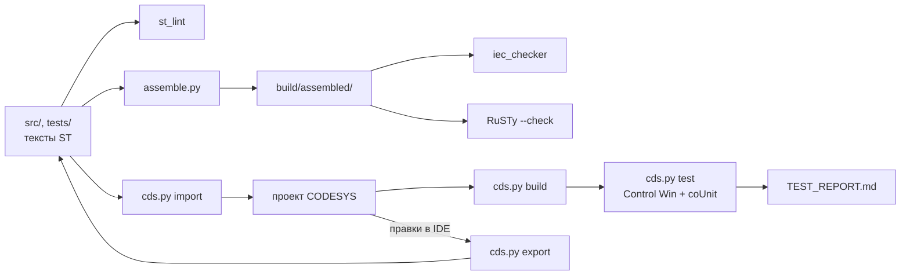

<p align="center">
  <picture>
    <source media="(prefers-color-scheme: dark)" srcset="docs/media/banner-dark.svg">
    <source media="(prefers-color-scheme: light)" srcset="docs/media/banner-light.svg">
    
  </picture>
</p>

<p align="center">
  <a href="https://github.com/<GITHUB_USER>/plc-repo-template/actions/workflows/ci.yml">/plc-repo-template/ci.yml?branch=main&style=flat-square&label=CI&labelColor=1B2736"></a>
  <a href="LICENSE"></a>
  
  
  <a href="docs/TEST_REPORT.md"></a>
  
  
  
</p>

<p align="center">
  <a href="#демонстрация">Демо</a> ·
  <a href="#архитектура">Архитектура</a> ·
  <a href="#быстрый-старт">Быстрый старт</a> ·
  <a href="docs/">Документация</a> ·
  <a href="#summary-en">Summary (EN)</a>
</p>

**ПЛК-код в git без бинарного проекта.** Шаблон репозитория для ПЛК-проектов на CODESYS V3.5
(3.5.17.30, целевой ПЛК — ОВЕН ПЛК210).
Решает главную проблему ПЛК-кода в git: проект CODESYS (`.project`) бинарный, его нельзя ревьюить
и сливать. Здесь источник истины — текстовые файлы ST, проект собирается из них скриптом, а
проверки (линтер, статанализ, проверка компиляции) идут в CI без CODESYS.

## Демонстрация

Всё ниже снято на машине разработки 19.10.2026 с коммита `007d648`: Windows 11, CODESYS 3.5.17.30 и
CODESYS Control Win V3 в пользовательском процессе. Вывод команд и окно IDE — как есть, макетов нет.

<p align="center">
  
</p>
<p align="center"><sub>Полный цикл в CODESYS из консоли: импорт → сборка → 18 тестов coUnit в Control Win → roundtrip без диффа. Реальный прогон, снято term2gif.py; ожидания укорочены (весь цикл — около минуты)</sub></p>

<p align="center">
  
</p>
<p align="center"><sub>Тот же проект в IDE: <code>build/plc-repo-template-tests.project</code> после <code>cds.py import --tests</code>. Снимок окна shot.py, нижняя строка сообщений обрезана — о ней <a href="docs/BUILD_ERRORS.md">BUILD_ERRORS.md</a></sub></p>

<p align="center">
  
</p>
<p align="center"><sub>Проверки без CODESYS и без лицензии — те же шаги, что в CI: ruff, mypy, pytest, assemble, st_lint, iec_checker 0.4, RuSTy 1.0.6. Реальный прогон, снято term2gif.py; вывод pytest показан ускоренно</sub></p>

## Архитектура



Подробно — [docs/ARCHITECTURE.md](docs/ARCHITECTURE.md).

## Почему такая раскладка

<p align="center">
  <picture>
    <source media="(prefers-color-scheme: dark)" srcset="docs/media/diagram-layout-dark.svg">
    <source media="(prefers-color-scheme: light)" srcset="docs/media/diagram-layout-light.svg">
    
  </picture>
</p>
<p align="center"><sub>Схема (не снимок IDE): какой файл какой объект проекта даёт <code>cds.py import</code>; реальное дерево — на снимке выше</sub></p>

- **Один объект CODESYS — один файл или папка** (`src/POUs/FB_Example/FB_Example.decl.st`,
  `Reset.method.impl.st`, `Count.get.impl.st`...). Дифф в pull request показывает, какой метод
  изменился, а не «изменился бинарный файл».
- **Объявление и тело — разные файлы**, как в редакторе CODESYS: импорт и экспорт однозначны,
  и цикл «импорт → экспорт» без правок не должен давать диффа (критерий проверки скриптов).
- **Склейка в стандартный ST** (`tools/assemble.py`) позволяет проверять код открытыми
  инструментами — iec_checker и RuSTy — без лицензии и без Windows.
- Контракт раскладки — [docs/LAYOUT.md](docs/LAYOUT.md), правила кода — [CONTRIBUTING.md](CONTRIBUTING.md).

## Быстрый старт

Без железа и без CODESYS: нужен только Python 3.11+ (в CI — 3.12).

```bash
python -m venv .venv
source .venv/bin/activate              # Windows: .venv\Scripts\activate
python -m pip install -r requirements-dev.txt

python -m pytest                       # тесты инструментов
python tools/check/st_lint.py --strict # правила CONTRIBUTING.md: заголовки, имена, «магические числа»
python tools/assemble.py --tests       # стандартный ST в build/assembled/

# статанализ: бинарник iec_checker v0.4 из релизов (--binary <путь> или переменная IEC_CHECKER)
# или Docker-образ (--docker jubnzv1/iec-checker:nightly)
python tools/check/run_iec_checker.py --binary <путь к iec_checker> --tests
# необязательно: проверка компиляции RuSTy (бинарник plc и stdlib из релиза PLC-lang/rusty v1.0.6)
python tools/check/run_rusty.py --plc <путь к plc> --stdlib <stdlib/include>
```

Отчёты — в `build/` (`iec_checker.md`, `rusty.log`). Опции инструментов — в
[tools/README.md](tools/README.md).

## CODESYS: импорт, сборка, тесты, экспорт

Нужны Windows, CODESYS 3.5.17.30 и Python 3.11+. Всё делает одна команда `tools/codesys/cds.py`:
она запускает CODESYS без окна (`--noUI`) со скриптами CODESYS Scripting, а тесты coUnit — в
CODESYS Control Win V3, запущенном пользовательским процессом (без прав администратора).

| Команда (из корня репозитория; cmd, PowerShell или Git Bash) | Что делает |
|---|---|
| `python tools/codesys/cds.py import` | `src/` → `build/<имя>.project` |
| `python tools/codesys/cds.py build` | импорт и сборка; ошибки — с файлом и строкой в `src/` |
| `python tools/codesys/cds.py check --tests` | компиляция всех объектов `src/` и `tests/`, в том числе не вызываемых из задач |
| `python tools/codesys/cds.py test` | `src/` + `tests/` → сборка → прогон в рантайме → `build/test-results.json`, `build/junit.xml` |
| `python tools/codesys/cds.py roundtrip` | импорт → экспорт → побайтное сравнение с `src/` и `tests/` |
| `python tools/codesys/cds.py export` | после правок в IDE: проект → `src/` (до коммита) |
| `python tools/codesys/cds.py report` | итоги прогона → `docs/TEST_REPORT.md` |
| `python tools/codesys/cds.py library --install` | `src/` → библиотека `build/<имя>.library` и установка в репозиторий библиотек |
| `python tools/codesys/cds.py deps` | библиотеки-зависимости: проверка, установка, сборка в соседних репозиториях |
| `python tools/codesys/cds.py runtime status` | рантайм; также `start`, `stop`, `restart`, `init` |

Путь к CODESYS и профиль — переменные `CODESYS_EXE`, `CODESYS_PROFILE` (без них — стандартный путь
установки 3.5.17.30); настройки проекта, устройства, задач и библиотек — `tools/codesys/config.json`.
Библиотека Standard (TON, R_TRIG, CTU, CONCAT) подключена по умолчанию плейсхолдером `#Standard`.
Проверено в CODESYS 3.5.17.30 / CODESYS Control Win V3 (пользовательский процесс): сборка и проверка
всех объектов без ошибок и предупреждений, тесты coUnit зелёные, цикл «импорт → экспорт» без диффа — см.
[docs/TEST_REPORT.md](docs/TEST_REPORT.md). Установка и первый запуск —
[docs/MANUAL_STEPS.md](docs/MANUAL_STEPS.md), все опции и переменные —
[tools/README.md](tools/README.md#codesyscdspy--codesys-из-консоли). Правило: правили в IDE —
`cds.py export` в `src/` до коммита.

## Как создать проект из шаблона

1. На GitHub: **Use this template → Create a new repository**.
2. Заменить плейсхолдеры `<ИМЯ ФАМИЛИЯ>` и `<GITHUB_USER>` (LICENSE, README, CONTRIBUTING.md, заголовки ST):
   `git grep -n -e "<ИМЯ ФАМИЛИЯ>" -e "<GITHUB_USER>"`.
3. Удалить пример (`FB_Example`, `ST_Example*`, константы `EXAMPLE_*`) или переименовать под задачу.
4. Обновить `CHANGELOG.md`, `docs/ASSUMPTIONS.md` и `tools/codesys/config.json` (для библиотеки —
   раздел `library`: название, компания, версия, пространство имён). Тесты `tools/tests/` берут
   настройки из своего эталона и от `config.json` проекта не зависят: задачи, библиотеки и раздел
   `library` меняются без исключения тестов шаблона.

## Зеркало на GitVerse или GitFlic

```bash
git remote add mirror <url>
git push mirror --all
git push mirror --tags
```

## Тесты и проверки

Статус CI — бейдж в шапке (workflow `.github/workflows/ci.yml`). Последний локальный прогон
(19.10.2026): 528 тестов pytest, 18 из 18 тестов coUnit в CODESYS Control Win V3, roundtrip без диффа —
[docs/TEST_REPORT.md](docs/TEST_REPORT.md).

| Проверка | Где | Что |
|---|---|---|
| ruff, mypy, pytest | CI | код инструментов на Python |
| `st_lint --strict` | CI | раскладка, заголовки POU, табы, длина строки, `TODO` без issue, «магические числа» |
| iec_checker | CI: v0.4 (как локально) — обязательно; образ `nightly` — необязательно | статанализ; находки — в [docs/STATIC_ANALYSIS.md](docs/STATIC_ANALYSIS.md) |
| RuSTy `plc --check` | CI, необязательно | синтаксис и типы собранного ST |
| сборка CODESYS 3.5.17.30 | Windows с CODESYS: `cds.py build` | ошибки и предупреждения компилятора — `build/build.log` |
| полная проверка компиляции | Windows с CODESYS: `cds.py check --tests` | все объекты `src/` и `tests/`, даже без вызовов из задач (`build` их не компилирует) — `build/check.log` |
| CfUnit (coUnit 1.2.0.0) | Windows с CODESYS: `cds.py test` (Control Win V3) | юнит-тесты ST; итоги — в [docs/TEST_REPORT.md](docs/TEST_REPORT.md) |
| roundtrip | Windows с CODESYS: `cds.py roundtrip` | «импорт → экспорт» без диффа, повторный импорт без изменений |

## Документация

- [ARCHITECTURE.md](docs/ARCHITECTURE.md) — схема работы и пример в `src/`
- [LAYOUT.md](docs/LAYOUT.md) — контракт раскладки исходников
- [MANUAL_STEPS.md](docs/MANUAL_STEPS.md) — шаги в IDE CODESYS
- [ASSUMPTIONS.md](docs/ASSUMPTIONS.md) — допущения и решения
- [STATIC_ANALYSIS.md](docs/STATIC_ANALYSIS.md), [TEST_REPORT.md](docs/TEST_REPORT.md),
  [BUILD_ERRORS.md](docs/BUILD_ERRORS.md) — отчёты
- [TZ_template.md](docs/TZ_template.md) (ГОСТ 34.602-2020), [PMI_template.md](docs/PMI_template.md) — шаблоны ТЗ и ПМИ

## Ограничения и дальнейшие шаги

- Сборка и тесты в CODESYS выполняются только на Windows с установленным CODESYS (не в CI GitHub):
  перед релизом — `cds.py test` и `cds.py report`.
- В раскладку не входят визуализации, дерево устройств, конфигураторы обмена, графические языки,
  `ACTION`, а Persistent Variables скриптом SP17 не создаются — это ручные шаги
  ([MANUAL_STEPS.md](docs/MANUAL_STEPS.md#6-работа-в-ide-и-экспорт-перед-коммитом)).
- iec_checker и RuSTy понимают не все расширения CODESYS: для них есть упрощённые варианты сборки,
  семантика которых может отличаться.
- Тесты — на CfUnit 1.2.0.0 (пространство имён `coUnit`); фреймворк не развивается с 2022 года.

## Summary (EN)

A template repository for CODESYS V3.5 (3.5.17.30) PLC projects targeting OWEN PLC210.
The binary `.project` file is not stored in git: plain-text Structured Text files in `src/` and
`tests/` (one CODESYS object per file or folder, see `docs/LAYOUT.md`) are the source of truth.
A single command, `python tools/codesys/cds.py import|build|test|export|roundtrip`, drives headless
CODESYS Scripting (IronPython) to build the project from the sources and export IDE edits back.
`tools/assemble.py` merges the sources into standard IEC 61131-3 ST, so CI on Linux can run a
linter, the iec_checker static analyser and the RuSTy compiler without a CODESYS licence.
CfUnit (coUnit 1.2.0.0) unit tests run in a user-mode CODESYS Control Win V3 runtime. Docs are in Russian.

## Лицензия

[MIT](LICENSE) © 2026 <ИМЯ ФАМИЛИЯ>

---

<p align="center"><b>Портфолио АСУ ТП</b></p>
<table>
<tr><td width="33%"><a href="https://github.com/<GITHUB_USER>/plc-repo-template"><b>01 · plc-repo-template</b></a><br><sub>ST в git, сборка проекта скриптом, CI</sub></td><td width="33%"><a href="https://github.com/<GITHUB_USER>/plc-process-lib">02 · plc-process-lib</a><br><sub>ФБ: AI, двигатель, ПЧ, задвижка, ПИД, тревоги</sub></td><td width="33%"><a href="https://github.com/<GITHUB_USER>/kns-pump-station">03 · kns-pump-station</a><br><sub>флагман: КНС, три насоса с ПЧ, модель, HMI</sub></td></tr>
<tr><td width="33%"><a href="https://github.com/<GITHUB_USER>/kns-port-domestic">04 · kns-port-domestic</a><br><sub>перенос на Astra.IDE / MasterSCADA 4D</sub></td><td width="33%"><a href="https://github.com/<GITHUB_USER>/plc-iiot-stack">05 · plc-iiot-stack</a><br><sub>OPC UA / MQTT → InfluxDB → Grafana</sub></td><td width="33%"><a href="https://github.com/<GITHUB_USER>/iolistgen">06 · iolistgen</a><br><sub>перечень сигналов → ST, карты Modbus, SCADA</sub></td></tr>
<tr><td width="33%"><a href="https://github.com/<GITHUB_USER>/plc-ci-toolkit">07 · plc-ci-toolkit</a><br><sub>линтеры, сборка CODESYS, тесты, JUnit</sub></td><td width="33%"><a href="https://github.com/<GITHUB_USER>/s7-to-codesys">08 · s7-to-codesys</a><br><sub>конвертер SCL → ST с отчётом о переносе</sub></td><td width="33%"><a href="https://github.com/<GITHUB_USER>/sis-interlock-demo">09 · sis-interlock-demo</a><br><sub>ПАЗ: MooN, матрица причин и следствий</sub></td></tr>
</table>
