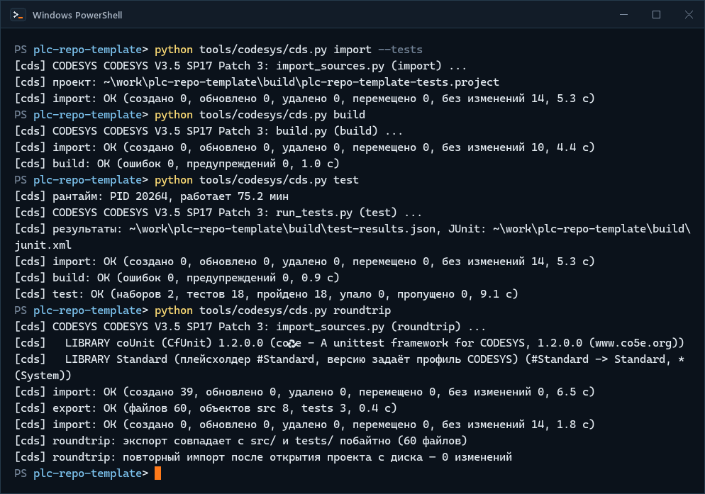
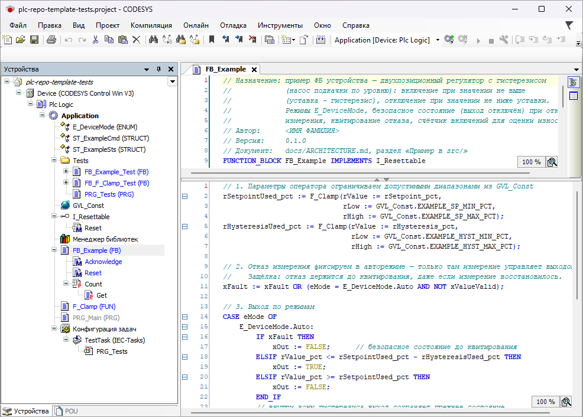
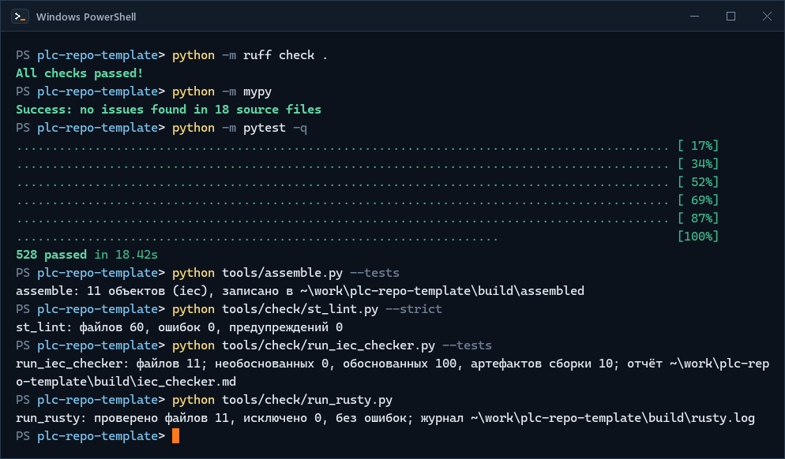
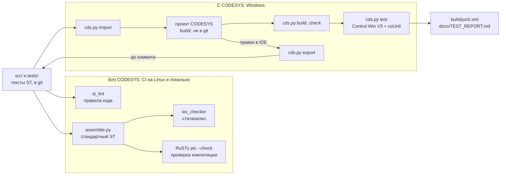
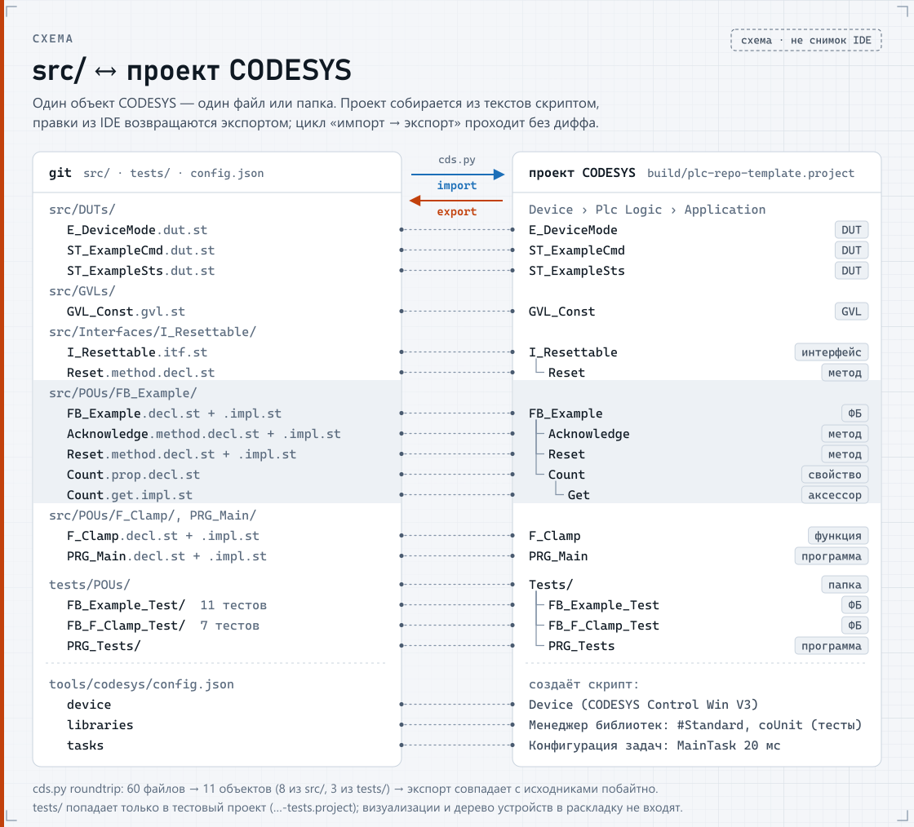

<p align="center">
  <picture>
    <source media="(prefers-color-scheme: dark)" srcset="docs/media/banner-dark.svg">
    <source media="(prefers-color-scheme: light)" srcset="docs/media/banner-light.svg">
    
  </picture>
</p>

<p align="center"><b>Код ПЛК на CODESYS V3.5 в git как текст: ревью в pull request, сборка и тесты из консоли, CI без лицензии</b></p>

<p align="center">
  <a href="https://github.com/kr0nsch/plc-repo-template/actions/workflows/ci.yml"></a>
  <a href="https://github.com/kr0nsch/plc-repo-template/releases/latest"></a>
  <a href="LICENSE"></a>
  
  <a href="#тесты-и-качество"></a>
</p>

<p align="center">
  <a href="#что-это-и-зачем">Что это</a> ·
  <a href="#быстрый-старт">Быстрый старт</a> ·
  <a href="#как-использовать-в-своём-проекте">Как использовать</a> ·
  <a href="#как-устроено">Как устроено</a> ·
  <a href="#документация">Документация</a> ·
  <a href="#summary-en">Summary (EN)</a>
</p>

**Шаблон репозитория для ПЛК-проектов на CODESYS V3.5 (проверено на SP17 Patch 3), где код хранится как
текст.** Проект CODESYS (`.project`) — бинарный файл: в git его нельзя ревьюить, сравнивать и сливать.
Здесь источник истины — файлы Structured Text в `src/` и `tests/` (объявление и тело каждого POU и
метода — отдельные файлы); проект собирается из них одной командой, а правки, сделанные в IDE,
выгружаются обратно в текст. Для инженеров и групп АСУ ТП, которым нужны ревью ПЛК-кода в pull request, CI и
воспроизводимая сборка.

## Что это и зачем

Шаблон GitHub (кнопка **Use this template**): структура репозитория, инструменты на Python и рабочий
пример с тестами. Вместо `.project` в git лежат тексты ST. Команда `tools/codesys/cds.py` создаёт из
них проект CODESYS, собирает его, прогоняет юнит-тесты в CODESYS Control Win V3 и выгружает правки из
IDE обратно в `src/`. Проверки, которым CODESYS не нужен (линтер, статанализ, проверка компиляции
открытым компилятором), идут в CI на Linux.

**Что даёт**

- **Ревью по объектам.** Объявление и тело каждого POU, метода и аксессора свойства — отдельные файлы:
  `FB_Example.decl.st`, `Reset.method.impl.st`, `Count.get.impl.st`. Дифф в pull request показывает
  изменённый метод, а не «изменился бинарный файл».
- **Сборка из консоли.** `cds.py build` создаёт проект из `src/` и собирает его; ошибки компилятора —
  с файлом и строкой в `src/`, например
  `src/POUs/F_Clamp/F_Clamp.impl.st:16: Error C0046 Идентификатор 'rValueX' не задан`.
- **Правки в IDE не теряются.** `cds.py export` выгружает проект обратно в тексты; `cds.py roundtrip`
  проверяет, что цикл «импорт → экспорт» возвращает те же файлы побайтно. `import` не перезапишет
  проект с невыгруженными правками из IDE, а `export` — тексты, изменённые после импорта.
- **Юнит-тесты ST из консоли.** `cds.py test` загружает тестовое приложение в CODESYS Control Win V3 и
  прогоняет тесты на coUnit (CfUnit 1.2.0.0 — открытый фреймворк юнит-тестов для CODESYS, MIT): итог в
  консоли и `build/junit.xml` для CI. В шаблоне 18 тестов, все пройдены.
- **CI без лицензии CODESYS.** ruff, mypy, pytest, линтер ST, статанализ iec_checker и проверка
  компиляции RuSTy — на GitHub-hosted Linux, на каждый push и pull request.
- **Без прав администратора.** Рантайм для тестов — пользовательский процесс, служба Windows не нужна.
- **Правила кода проверяются автоматически.** Линтер `st_lint` проверяет правила
  [CONTRIBUTING.md](CONTRIBUTING.md): заголовки POU, префиксы имён, «магические числа», длину строк.

**Для кого**

- инженеры и группы АСУ ТП на CODESYS V3.5, которым нужны ревью ПЛК-кода через pull request, CI и
  воспроизводимая сборка;
- интеграторы и машиностроители, которые ведут много однотипных проектов и хотят одинаковую структуру
  репозиториев; как перенести уже существующий проект — в
  [USAGE.md, раздел 10](docs/USAGE.md#10-перенос-существующего-проекта) (на реальном проекте не
  проверялось);
- технические руководители, которые оценивают текстовый процесс разработки ПЛК-кода.

**Платформа.** Проверено на CODESYS V3.5 SP17 Patch 3 (3.5.17.30, 32-битная сборка ОВЕН) и CODESYS
Control Win V3. Целевой ПЛК — ОВЕН ПЛК210, на железе шаблон не проверялся; устройство проекта задаётся
в `tools/codesys/config.json` → `device` (варианты — в `_alternatives`). Сборка и тесты в CODESYS —
только на Windows; проверки без CODESYS — на Windows и Linux с Python 3.11+.

**Другая версия или дистрибутив CODESYS V3.5** (не проверялось): путь и профиль — переменные
`CODESYS_EXE` и `CODESYS_PROFILE`, версия устройства — `CDS_DEVICE_VERSION`, для 64-битного Control Win V3
ещё `CDS_DEVICE_ID` = `0000 0004`; coUnit 1.2.0.0 должна быть установлена в этой версии. Что ещё
поменять для тестов в рантайме — [USAGE.md](docs/USAGE.md#другая-версия-или-дистрибутив-codesys).

## Как это выглядит

Реальные прогоны и окно IDE: Windows 11, CODESYS 3.5.17.30, CODESYS Control Win V3. Макетов нет.

<p align="center">
  
</p>
<p align="center"><sub>Полный цикл в CODESYS из консоли: импорт → сборка → 18 тестов coUnit в Control Win → roundtrip без диффа. Ожидания укорочены, весь цикл — около минуты</sub></p>

<p align="center">
  
</p>
<p align="center"><sub>Тот же проект в IDE: <code>build/plc-repo-template-tests.project</code> после <code>cds.py import --tests</code> — объекты и папки из файлов <code>src/</code> и <code>tests/</code>. Окно сообщений в кадр не вошло: при открытии проекта в IDE менеджер библиотек сообщает о плейсхолдере <code>#CBML</code>; на сборку и тесты это не влияет (0 ошибок, 18 из 18), причина не разобрана — <a href="docs/BUILD_ERRORS.md">BUILD_ERRORS.md</a></sub></p>

<p align="center">
  
</p>
<p align="center"><sub>Проверки без CODESYS и без лицензии — те же шаги, что в CI: ruff, mypy, pytest, assemble, st_lint, iec_checker 0.4, RuSTy 1.0.6. Вывод pytest ускорен; на момент записи тестов было 528, сейчас 534</sub></p>

<details>
<summary>Когда и с чего снято</summary>

Все записи и снимок сделаны 19.10.2026 на машине разработки; CODESYS Control Win V3 работал в
пользовательском процессе. Записи терминала — с коммита `007d648`, снимок IDE — с исходников версии
1.0.0 (от `007d648` они отличаются только строкой «Автор» в заголовках POU). Вывод команд и окно IDE —
как есть.

</details>

## Быстрый старт

Два уровня: проверки без CODESYS работают на любой машине с Python (так же, как CI); сборка и тесты в
CODESYS — на Windows с установленным CODESYS. Железо ПЛК не нужно ни там, ни там.

### Без CODESYS: Windows или Linux

Нужно: Python 3.11+ (в CI — 3.12) и git. Для шагов 6 и 7 — бинарники iec_checker v0.4 и RuSTy v1.0.6
из их релизов (установка не нужна).

1. Получить код:

   ```bash
   git clone https://github.com/kr0nsch/plc-repo-template.git
   cd plc-repo-template
   ```

   Увидите: `Cloning into 'plc-repo-template'...`; в каталоге — `src/`, `tests/`, `tools/`, `docs/`.

2. Окружение и зависимости для разработки (ruff, mypy, pytest, hypothesis):

   ```bash
   python -m venv .venv          # Linux: python3 -m venv .venv (в Debian/Ubuntu — пакет python3-venv)
   source .venv/bin/activate     # Git Bash: source .venv/Scripts/activate
   python -m pip install -r requirements-dev.txt
   ```

   В cmd окружение активирует `.venv\Scripts\activate.bat`, в PowerShell — `.venv\Scripts\Activate.ps1`;
   если PowerShell запрещает скрипты (политика Windows по умолчанию — `Restricted`), сначала выполните
   `Set-ExecutionPolicy -Scope Process -ExecutionPolicy Bypass` (действует только в этом окне) или
   работайте в cmd либо Git Bash.

   Увидите: `Successfully installed …`, в списке — `hypothesis-6.170.0`, `mypy-2.4.0`, `pytest-9.1.1`,
   `ruff-0.17.1`.

3. Тесты инструментов:

   ```bash
   python -m pytest
   ```

   Увидите: `534 passed`. Если iec_checker и RuSTy ещё не скачаны — `524 passed, 10 skipped`:
   интеграционные тесты с настоящими анализаторами пропускаются.

4. Линтер ST по правилам [CONTRIBUTING.md](CONTRIBUTING.md):

   ```bash
   python tools/check/st_lint.py --strict
   ```

   Увидите: `st_lint: файлов 60, ошибок 0, предупреждений 0`.

5. Склейка раскладки в стандартный ST для анализаторов:

   ```bash
   python tools/assemble.py --tests
   ```

   Увидите: `assemble: 11 объектов (iec), записано в …/build/assembled`.

6. Статанализ. Скачайте из [релиза iec_checker v0.4](https://github.com/iec-checker/iec-checker/releases/tag/v0.4)
   файл `iec_checker_Windows_x86_64.exe` или `iec_checker_Linux_x86_64` (в Linux — `chmod +x`) и положите
   в `~/.local/plc-tools/iec-checker/` — там его найдёт `run_iec_checker.py`; другой путь — `--binary <путь>`
   или переменная `IEC_CHECKER`.

   ```bash
   python tools/check/run_iec_checker.py --tests
   ```

   Увидите: `run_iec_checker (v0.4): файлов 11; необоснованных 0, обоснованных 100, артефактов сборки 10; отчёт …/build/iec_checker.md`.
   Каждая обоснованная находка разобрана в [docs/STATIC_ANALYSIS.md](docs/STATIC_ANALYSIS.md).

7. Необязательно — проверка компиляции RuSTy. Из [релиза RuSTy v1.0.6](https://github.com/PLC-lang/rusty/releases/tag/v1.0.6)
   скачайте `plc.exe` (в Linux — `plc-linux-x86_64`, переименовать в `plc` и `chmod +x`) и `stdlib-1.0.6.tar.gz` в
   `~/.local/plc-tools/rusty/` и распакуйте архив там же (`tar -xzf stdlib-1.0.6.tar.gz` — получится
   `stdlib/include/` рядом с `plc`). Другие пути — `--plc <путь>` и `--stdlib <каталог include>`.

   ```bash
   python tools/check/run_rusty.py
   ```

   Увидите: `run_rusty: проверено файлов 11, исключено 0, без ошибок; журнал …/build/rusty.log`.

Отчёты — в `build/`: `iec_checker.md`, `iec_checker.json`, `rusty.log`. Опции всех инструментов — в
[tools/README.md](tools/README.md).

### С CODESYS: Windows

Нужно:

- CODESYS V3.5 SP17 Patch 3 (3.5.17.30) с компонентом CODESYS Control Win V3 —
  [MANUAL_STEPS.md, раздел 1](docs/MANUAL_STEPS.md#1-установка-codesys-351730). Стандартный путь
  установки `cds.py` находит сам, другой — переменные `CODESYS_EXE` и `CODESYS_PROFILE`
  ([раздел 3](docs/MANUAL_STEPS.md#3-переменные-окружения));
- библиотека coUnit 1.2.0.0 с CODESYS Forge в репозитории библиотек CODESYS или путь к ней в
  `COUNIT_LIBRARY` — [раздел 2](docs/MANUAL_STEPS.md#2-counit-cfunit-1200);
- Python 3.11+ без сторонних пакетов. Права администратора не нужны.

Каждая команда запускает CODESYS без окна и длится 10–20 секунд; журналы — в `build/`.

1. Собрать проект из `src/`:

   ```bat
   python tools\codesys\cds.py build
   ```

   Увидите: `[cds] build: OK (ошибок 0, предупреждений 0, …)`. Проект — `build\plc-repo-template.project`.

2. Проверить компиляцию всех объектов, в том числе тестов и не вызываемых из задач:

   ```bat
   python tools\codesys\cds.py check --tests
   ```

   Увидите: `[cds] check: все объекты src/ и tests/ скомпилированы без ошибок (11 объектов)`.

3. Прогнать юнит-тесты в CODESYS Control Win V3 (рантайм `cds.py` запускает сам, при первом запуске
   готовит его каталог и файл учётных данных тестового пользователя —
   [раздел 4](docs/MANUAL_STEPS.md#4-рантайм-codesys-control-win-v3-без-прав-администратора)):

   ```bat
   python tools\codesys\cds.py test
   ```

   Увидите: `[cds] test: OK (наборов 2, тестов 18, пройдено 18, упало 0, пропущено 0, …)`; результаты —
   `build\test-results.json` и `build\junit.xml`.

4. Проверить цикл «импорт → экспорт»:

   ```bat
   python tools\codesys\cds.py roundtrip
   ```

   Увидите: `[cds] roundtrip: экспорт совпадает с src/ и tests/ побайтно (60 файлов)`.

Посмотреть проект в IDE без скриптов — готовый `plc-repo-template.project` в
[релизе v1.0.0](https://github.com/kr0nsch/plc-repo-template/releases/tag/v1.0.0).

## Как использовать в своём проекте

Кратко; подробно, с чек-листами и полным примером, — [docs/USAGE.md](docs/USAGE.md).

**Уже есть проект CODESYS?** Объекты на ST из его приложения выгружает в `src/` команда `cds.py export`
(по копии проекта в `build\<имя>.project`); задачи и библиотеки переносятся в `config.json`, затем
проект пересобирается из текстов. Не переносятся `ACTION`, POU на графических языках, визуализации и
дерево устройств. Путь собран по коду инструментов и на реальном проекте не проверялся —
[USAGE.md, раздел 10](docs/USAGE.md#10-перенос-существующего-проекта).

1. **Создать репозиторий.** **Use this template → Create a new repository**, клонировать. Имя каталога —
   имя проекта CODESYS: `build\<имя>.project`, `build\<имя>-tests.project`.
2. **Сделать своим.** Заменить автора и имя шаблона — их места покажет
   `git grep -n -e kr0nsch -e plc-repo-template -- . ":!tools/tests"` ([чек-лист](docs/USAGE.md#2-переименовать-под-свой-проект)).
   Удалить пример `FB_Example` по [чек-листу](docs/USAGE.md#3-удалить-пример): кроме файлов `src/` и
   `tests/` в нём правка `PRG_Main`, `PRG_Tests` и файла обоснований iec_checker — без неё CI упадёт
   на `pytest`.
3. **Работать каждый день** одним из двух способов:
   - *правка текста* — изменить `src/**/*.st` в любом редакторе → `python tools/check/st_lint.py --strict`
     → с CODESYS `cds.py build`, `check --tests`, `test` → коммит;
   - *правка в IDE* — цикл ниже. Правило одно: правили в IDE — `cds.py export` до коммита.

   ```bat
   python tools\codesys\cds.py import
   rem открыть build\<имя>.project в IDE, править, сохранить проект и закрыть IDE
   python tools\codesys\cds.py export
   git diff --stat
   python tools\codesys\cds.py test
   git add src tests
   git commit
   ```

   Пока проект открыт в IDE, команды, которые открывают этот же файл, отказываются с кодом выхода 3:
   для `build\<имя>.project` — `import`, `build`, `export`; для `build\<имя>-tests.project` —
   `import --tests`, `build --tests`, `export --tests` и `test`. `import` не перезапишет проект,
   сохранённый в IDE после последнего `import`/`export` (сначала `export`, или `--force`, если правки
   не нужны); `export` не перезапишет `src/`, изменённый после последнего `import`/`export` (сравнить —
   `export --to build\cmp`, перезаписать — `--force`). С тестами — `import --tests` и `export --tests`.
4. **Добавить свой код.** POU — папка с файлами объявления и тела (DUT и GVL — один файл, интерфейс —
   папка с объявлениями без тел; [docs/LAYOUT.md](docs/LAYOUT.md#типы-файлов)), тест — метод набора
   coUnit, набор — экземпляр в `PRG_Tests`. Пример из шаблона — функция `F_Clamp`:

   ```text
   src/POUs/F_Clamp/
     F_Clamp.decl.st                     заголовок и объявление
     F_Clamp.impl.st                     тело
   tests/POUs/FB_F_Clamp_Test/
     FB_F_Clamp_Test.decl.st             набор: FUNCTION_BLOCK ... EXTENDS coUnit.FB_TestSuite
     FB_F_Clamp_Test.impl.st             вызовы методов-тестов
     BelowLowReturnsLow.method.decl.st   тест: объявление метода
     BelowLowReturnsLow.method.impl.st   тест: тело
   tests/POUs/PRG_Tests/                 регистрация набора
   ```

   Заголовок POU обязателен — без него `st_lint` выдаёт ошибку STL001 (`F_Clamp.decl.st`, сокращено):

   ```st
   // Назначение: ограничение значения отрезком между двумя границами.
   // Автор:      kr0nsch
   // Версия:     0.1.0
   // Документ:   docs/ASSUMPTIONS.md, раздел «Семантика F_Clamp»
   FUNCTION F_Clamp : REAL
   VAR_INPUT
       rValue : REAL;      // ограничиваемое значение
       rLow : REAL;        // нижняя граница
       rHigh : REAL;       // верхняя граница
   END_VAR
   ```

   Тест — метод набора (`BelowLowReturnsLow.method.impl.st`):

   ```st
   coUnit.TEST('BelowLowReturnsLow');

   rResult := F_Clamp(rValue := R_BELOW, rLow := R_LOW, rHigh := R_HIGH);
   AssertEquals_REAL(Expected := R_LOW,
                     Actual := rResult,
                     Delta := R_DELTA,
                     Message := 'Value below range must be clamped to rLow');

   coUnit.TEST_FINISHED();
   ```

   Набор регистрируется в coUnit объявлением экземпляра в `PRG_Tests`; `coUnit.RUN()` выполняет все
   зарегистрированные наборы, а `cds.py test` ждёт признака раннера coUnit `AllTestSuitesFinished`.
   Флаг `xAllFinished` — сводный признак окончания наборов внутри программы (`cds.py test` его не
   читает); новый набор добавляют в него так же, как в шаблоне (наборов два):

   ```st
   // PRG_Tests.decl.st, секция VAR
   fbF_ClampTest : FB_F_Clamp_Test;    // тесты F_Clamp
   // PRG_Tests.impl.st, после coUnit.RUN();
   xAllFinished := fbF_ClampTest.AreAllTestsFinished() AND fbExampleTest.AreAllTestsFinished();
   ```

5. **Задачи, устройство и библиотеки** — в `tools/codesys/config.json`, а не в IDE: новая программа
   получает задачу в `modes.normal.tasks` (сейчас `MainTask`, 20 мс → `PRG_Main`), их создаёт `import`
   ([USAGE.md, раздел 6](docs/USAGE.md#6-задачи-устройство-и-библиотеки-configjson)).
6. **Push.** CI проверяет всё, что не требует CODESYS ([«Тесты и качество»](#тесты-и-качество)).
   Сборку и тесты в CODESYS запускают перед слиянием на Windows или на своём Windows-раннере
   ([plc-ci-toolkit](https://github.com/kr0nsch/plc-ci-toolkit)).
7. **Релиз.** `.project` и `.library` в git не хранятся — их прикладывают к релизу GitHub
   ([MANUAL_STEPS.md, раздел 7](docs/MANUAL_STEPS.md#7-релиз-и-библиотеки-project-library-зависимости)).

## Как устроено



<p align="center">
  <picture>
    <source media="(prefers-color-scheme: dark)" srcset="docs/media/diagram-layout-dark.svg">
    <source media="(prefers-color-scheme: light)" srcset="docs/media/diagram-layout-light.svg">
    
  </picture>
</p>
<p align="center"><sub>Схема (не снимок IDE): какой файл какой объект проекта даёт <code>cds.py import</code>; реальное дерево — на снимке выше</sub></p>

| Каталог | Назначение |
|---|---|
| `src/` | исходники приложения: DUT, GVL, интерфейсы, POU с методами и свойствами; объявление и тело — отдельные файлы |
| `tests/` | наборы тестов coUnit и программа запуска `PRG_Tests` в той же раскладке; при импорте — папка проекта `Tests` |
| `tools/` | `assemble.py` — склейка в стандартный ST; `check/` — линтер, запуск iec_checker и RuSTy; `codesys/` — `cds.py`, скрипты CODESYS Scripting, `config.json` |
| `docs/` | руководства, отчёты проверок, журнал решений, шаблоны ТЗ и ПМИ |
| `.github/workflows/` | CI без CODESYS |
| `build/` | проекты CODESYS, собранный ST, журналы и отчёты; в git не хранится |

Почему так:

- **Объявление и тело — разные файлы**, как в редакторе CODESYS: импорт и экспорт однозначны, и цикл
  «импорт → экспорт» без правок не даёт диффа.
- **Склейка в стандартный ST** (`tools/assemble.py`) позволяет проверять код открытыми инструментами —
  iec_checker и RuSTy — без лицензии и без Windows.
- **Задачи, устройство и библиотеки — в `config.json`**: проект целиком воспроизводится из репозитория.
- Контракт раскладки — [docs/LAYOUT.md](docs/LAYOUT.md), контуры проверок и пример —
  [docs/ARCHITECTURE.md](docs/ARCHITECTURE.md).

## Тесты и качество

| Проверка | Где | Что проверяет |
|---|---|---|
| ruff, ruff format, mypy, pytest | CI, обязательно | код инструментов на Python: раскладка, склейка, линтер, запуск анализаторов, `cds.py` без CODESYS |
| `st_lint --strict` | CI, обязательно | раскладка, заголовки POU, префиксы имён, табы, длина строки, `TODO` без issue, «магические числа» |
| iec_checker v0.4 | CI, обязательно; образ `nightly` — необязательно | статанализ; находки исправлены или обоснованы в [docs/STATIC_ANALYSIS.md](docs/STATIC_ANALYSIS.md) |
| RuSTy `plc --check` | CI, необязательно | синтаксис и типы собранного ST |
| `cds.py build` | Windows с CODESYS | ошибки и предупреждения компилятора CODESYS — `build/build.log` |
| `cds.py check --tests` | Windows с CODESYS | все объекты `src/` и `tests/`, даже без вызовов из задач (`build` их не компилирует) — `build/check.log` |
| `cds.py test` | Windows с CODESYS, Control Win V3 | юнит-тесты ST на coUnit 1.2.0.0 — `build/junit.xml`, [docs/TEST_REPORT.md](docs/TEST_REPORT.md) |
| `cds.py roundtrip` | Windows с CODESYS | «импорт → экспорт» без диффа, повторный импорт без изменений |

**Что проверено.** В CODESYS 3.5.17.30 / CODESYS Control Win V3 (19.10.2026, коммит `defb1d3`): сборка и
проверка всех объектов — 0 ошибок и 0 предупреждений, 18 из 18 тестов coUnit, roundtrip без диффа
(60 файлов) — [docs/TEST_REPORT.md](docs/TEST_REPORT.md). Без CODESYS на текущих исходниках: 534 теста
pytest, `st_lint` — 60 файлов без замечаний, iec_checker — 0 необоснованных находок, RuSTy — 0 ошибок.
На ПЛК210 код не запускался.

**CI** (`.github/workflows/ci.yml`) запускается на каждый push и pull request. Обязательное задание —
ruff, mypy, pytest, assemble, st_lint и iec_checker v0.4 (бинарник закреплён по SHA-256); iec_checker
`nightly` и RuSTy — необязательные задания (`continue-on-error`). Итоги — в сводке запуска, отчёты — в
артефактах (`build-reports`). Сборки и тестов в CODESYS в CI GitHub нет: их запускают на Windows
(см. [«Быстрый старт»](#с-codesys-windows)) или на своём раннере через
[plc-ci-toolkit](https://github.com/kr0nsch/plc-ci-toolkit). Подробно — [USAGE.md, раздел 8](docs/USAGE.md#8-ci).

## Документация

| Документ | На какой вопрос отвечает |
|---|---|
| [docs/USAGE.md](docs/USAGE.md) | как создать свой проект из шаблона и работать с ним каждый день |
| [docs/MANUAL_STEPS.md](docs/MANUAL_STEPS.md) | как установить CODESYS и coUnit, запустить рантайм, работать в IDE, выпустить релиз и библиотеку |
| [docs/LAYOUT.md](docs/LAYOUT.md) | какой файл какому объекту CODESYS соответствует |
| [tools/README.md](tools/README.md) | все команды, опции, переменные окружения и коды выхода инструментов |
| [docs/ARCHITECTURE.md](docs/ARCHITECTURE.md) | как устроены два контура проверок и что делает пример `FB_Example` |
| [CONTRIBUTING.md](CONTRIBUTING.md) | правила именования и кода ST, которые проверяет линтер |
| [docs/ASSUMPTIONS.md](docs/ASSUMPTIONS.md) | почему решено так, а не иначе (журнал допущений и решений) |
| [docs/TEST_REPORT.md](docs/TEST_REPORT.md) | что проверено в CODESYS и без него, с каким итогом |
| [docs/STATIC_ANALYSIS.md](docs/STATIC_ANALYSIS.md) | какие находки iec_checker обоснованы и почему; итог RuSTy |
| [docs/BUILD_ERRORS.md](docs/BUILD_ERRORS.md) | какие сообщения IDE разобраны и какие открыты (сейчас — `#CBML`); куда вставлять новые |
| [docs/TZ_template.md](docs/TZ_template.md), [docs/PMI_template.md](docs/PMI_template.md) | шаблоны ТЗ (ГОСТ 34.602-2020) и таблицы проверок ПМИ |
| [CHANGELOG.md](CHANGELOG.md) | что изменилось от версии к версии |

Зеркало на GitVerse или GitFlic — [MANUAL_STEPS.md, раздел 8](docs/MANUAL_STEPS.md#8-зеркало-на-gitverse-или-gitflic).

## Ограничения и планы

- Сборка и тесты в CODESYS выполняются только на Windows с установленным CODESYS, в CI GitHub их нет:
  перед релизом — `cds.py test` и `cds.py report`.
- Проверено только на CODESYS 3.5.17.30 (32-битная сборка ОВЕН) с CODESYS Control Win V3. На ПЛК210 и
  других версиях CODESYS не запускалось; что поменять для другой версии —
  [USAGE.md](docs/USAGE.md#другая-версия-или-дистрибутив-codesys).
- Открытый вопрос: при открытии тестового проекта в IDE менеджер библиотек сообщает «Невозможно открыть
  библиотеку '#CBML'». На сборку без окна и тесты это не влияет (0 ошибок, 18 из 18), причина не
  разобрана — [BUILD_ERRORS.md](docs/BUILD_ERRORS.md).
- В раскладку не входят визуализации, дерево устройств, конфигураторы обмена, графические языки,
  `ACTION`, а Persistent Variables скриптом в SP17 не создаются — это ручные шаги
  ([MANUAL_STEPS.md](docs/MANUAL_STEPS.md#6-работа-в-ide-и-экспорт-перед-коммитом)).
- iec_checker и RuSTy понимают не все расширения CODESYS: для них есть упрощённые варианты сборки,
  семантика которых может отличаться ([tools/README.md](tools/README.md#что-понижение-скрывает-и-добавляет)).
- Тесты — на CfUnit 1.2.0.0 (пространство имён `coUnit`); фреймворк не развивается с 2022 года.

Реализовано, но не выполнялось (в [MANUAL_STEPS.md](docs/MANUAL_STEPS.md) и [USAGE.md](docs/USAGE.md)
такие места отмечены):

- первый вход на свежий рантайм без пользователей — скрипт создаёт пользователя сам
  ([раздел 4](docs/MANUAL_STEPS.md#4-рантайм-codesys-control-win-v3-без-прав-администратора));
- установка coUnit из файла `COUNIT_LIBRARY` — тот же код проверен на другой библиотеке
  ([раздел 2](docs/MANUAL_STEPS.md#2-counit-cfunit-1200));
- открытие проекта в IDE из консоли с ключом `--project`
  ([раздел 6](docs/MANUAL_STEPS.md#6-работа-в-ide-и-экспорт-перед-коммитом));
- выпуск библиотеки через меню IDE — проверен только путь через `cds.py`
  ([раздел 7.1](docs/MANUAL_STEPS.md#71-выпуск-релиза));
- перенос существующего проекта через `cds.py export` — путь описан по коду инструментов
  ([USAGE.md, раздел 10](docs/USAGE.md#10-перенос-существующего-проекта)).

Что осталось проверить (статус «проверить» в [ASSUMPTIONS.md](docs/ASSUMPTIONS.md)): первый вход на
рантайм на чистой машине и параметры библиотеки coUnit на ПЛК210 с его меньшим объёмом памяти. Для
переноса на ПЛК210 нужно устройство из таргет-файла ОВЕН, версию которого сверяют с прошивкой
контроллера.

## Связанные проекты

Инструменты шаблона (`tools/`) — общая основа ПЛК-репозиториев портфолио:

- [plc-process-lib](https://github.com/kr0nsch/plc-process-lib) — библиотека технологических ФБ на этом
  шаблоне: собирается командой `cds.py library` и подключается к проектам через `config.json` →
  `libraries` (`cds.py deps` соберёт её из соседнего каталога);
- [plc-ci-toolkit](https://github.com/kr0nsch/plc-ci-toolkit) — переиспользуемые workflow GitHub Actions
  для репозиториев на шаблоне: те же проверки без CODESYS и сборка с тестами coUnit в CODESYS на своём
  Windows-раннере;
- на тех же инструментах — [s7-to-codesys](https://github.com/kr0nsch/s7-to-codesys) и
  [sis-interlock-demo](https://github.com/kr0nsch/sis-interlock-demo); флагманский проект КНС
  (kns-pump-station) готовится.

С чего начать: новый проект — с этого шаблона; CI со сборкой в CODESYS — добавить plc-ci-toolkit;
готовые ФБ устройств — plc-process-lib. Все проекты — в таблице внизу страницы.

## Summary (EN)

A GitHub template for CODESYS V3.5 PLC projects (tested on SP17 Patch 3) that keeps Structured Text in git
instead of the binary `.project`: one file per declaration and per body of each POU, method and property
accessor (`docs/LAYOUT.md`), so a pull request shows which method changed. `python tools/codesys/cds.py`
drives headless CODESYS to build the project from these files, run coUnit (CfUnit) unit tests in a user-mode
Control Win V3 runtime with JUnit output, and export IDE edits back to text (byte-for-byte round trip).
CI on Linux runs a linter, iec_checker and the RuSTy compiler without a CODESYS licence. Verified with
CODESYS 3.5.17.30 (18/18 tests), not on PLC hardware. Getting started and migrating an existing project
(not yet tried on a real one): `docs/USAGE.md`. Docs are in Russian.

## Лицензия

[MIT](LICENSE) © 2026 kr0nsch

---

<p align="center"><b>Портфолио АСУ ТП</b></p>
<table>
<tr><td width="33%"><a href="https://github.com/kr0nsch/plc-repo-template"><b>01 · plc-repo-template</b></a><br><sub>ST в git, сборка проекта скриптом, CI</sub></td><td width="33%"><a href="https://github.com/kr0nsch/plc-process-lib">02 · plc-process-lib</a><br><sub>ФБ: AI, двигатель, ПЧ, задвижка, ПИД, тревоги</sub></td><td width="33%"><span data-repo="kns-pump-station">03 · kns-pump-station</span> <sub>(готовится)</sub><br><sub>флагман: КНС, три насоса с ПЧ, модель, HMI</sub></td></tr>
<tr><td width="33%"><a href="https://github.com/kr0nsch/kns-port-domestic">04 · kns-port-domestic</a><br><sub>перенос на Astra.IDE / MasterSCADA 4D</sub></td><td width="33%"><span data-repo="plc-iiot-stack">05 · plc-iiot-stack</span> <sub>(готовится)</sub><br><sub>OPC UA / MQTT → InfluxDB → Grafana</sub></td><td width="33%"><a href="https://github.com/kr0nsch/iolistgen">06 · iolistgen</a><br><sub>перечень сигналов → ST, карты Modbus, SCADA</sub></td></tr>
<tr><td width="33%"><a href="https://github.com/kr0nsch/plc-ci-toolkit">07 · plc-ci-toolkit</a><br><sub>линтеры, сборка CODESYS, тесты, JUnit</sub></td><td width="33%"><a href="https://github.com/kr0nsch/s7-to-codesys">08 · s7-to-codesys</a><br><sub>конвертер SCL → ST с отчётом о переносе</sub></td><td width="33%"><a href="https://github.com/kr0nsch/sis-interlock-demo">09 · sis-interlock-demo</a><br><sub>ПАЗ: MooN, матрица причин и следствий</sub></td></tr>
</table>
